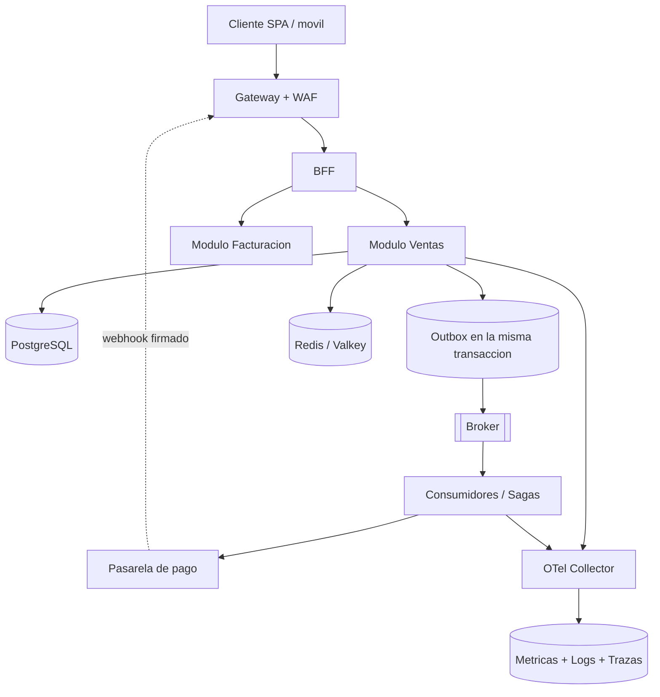

# Arquitectura de una aplicación .NET empresarial de gran escala — informe de referencia

> **Nota 2026-10-16**: referencia general, no describe este repo. El árbol de §3 organiza cada módulo por capas (`Ventas.Api`, `Ventas.Domain`…). Este repo no lo sigue: usa vertical slices en un solo proyecto, según [ADR-0004](../adr/0004-vertical-slices-deep-modules.md).

**Alcance**: informe genérico y autocontenido sobre .NET en producción grande. No usa ningún repositorio local como ejemplo. Todo lo verificado tiene fuente enlazada; lo no verificado está marcado al final.

**Idea central, primero**: en 2026 la decisión cara no es "microservicios sí o no", sino **qué dependencias adoptás y qué licencia te obligan a pagar**. Tres librerías que eran el estándar de facto (MediatR, AutoMapper, MassTransit) pasaron a licencia comercial, FluentAssertions también, y Polly empezó a cobrar un mantenimiento a partir de noviembre de 2026. La arquitectura sostenible se diseña ahora **alrededor de licencias**, no solo de patrones.

---

## 1. Plataforma base y ventana de soporte

| Componente | Estado | Dato verificado |
|---|---|---|
| .NET 10 | **LTS**, lanzado 11/11/2025, soporte hasta **14/11/2028** | [Política oficial de soporte](https://dotnet.microsoft.com/en-us/platform/support/policy) |
| .NET 9 | STS, termina **10/11/2026** | [.NET 8 y 9 fin de soporte](https://devblogs.microsoft.com/dotnet/dotnet-8-9-end-of-support) |
| .NET 8 | LTS, termina 10/11/2026 | mismo |
| .NET 11 | STS, previsto 10/11/2026 | [releases.md de dotnet/core](https://github.com/dotnet/core/blob/main/releases.md) |

Regla práctica: **producción sobre LTS**. Un STS en producción obliga a migrar cada 12-18 meses; a escala eso es un proyecto, no una tarea.

---

## 2. Estilo arquitectónico: el orden en que hay que decidir

No se elige el estilo por moda. Se elige por número de equipos, límites de despliegue y acoplamiento real.



**2.1 Modular monolith primero.** Un monolito modular es un solo despliegue con límites internos duros: módulos por contexto delimitado, comunicación entre módulos por contratos explícitos, base de datos propia por módulo (schemas separados), sin llamadas al interior de otro módulo. Es el estado del arte documentado para .NET: los recursos sobre arquitectura modular son consistentes en describirlo como el punto de partida correcto ([episodio de Microsoft con "modular monoliths"](https://learn.microsoft.com/en-us/shows/on-dotnet/on-dotnet-live-clean-architecture-vertical-slices-and-modular-monoliths-oh-my), [capítulo 11 de *Fundamentals of Software Architecture*](https://learning.oreilly.com/library/view/fundamentals-of-software/9781098175504/ch11.html)).

**2.2 Microservicios solo cuando el dolor es medible.** Criterios: equipos que se bloquean entre sí en el mismo despliegue; escalado muy distinto entre capacidades; dominios con ciclos de vida de datos independientes; requisitos regulatorios de aislamiento. Sin eso, los microservicios cambian un problema de código por uno de red, y la factura llega en latencia, consistencia y operación.

### 2.3 Patrones que sí pagan a escala

| Patrón | Qué resuelve | Cuándo entra |
|---|---|---|
| **Vertical slices** | Acoplamiento por caso de uso en lugar de por capa; los cambios quedan locales | Siempre, dentro de cada módulo |
| **Ports & adapters (hexagonal)** | Aislar el dominio de infraestructura y de terceros | Cuando hay proveedores externos o varias bases |
| **Anti-corruption layer** | Impedir que el modelo del proveedor contamine el propio | Toda integración con sistema legacy o SaaS |
| **CQRS (solo separar lectura)** | Optimizar lecturas sin tocar el modelo de escritura | Cuando las consultas son el cuello de botella |
| **Event sourcing** | Auditoría total y reconstrucción de estado | Dominios con requisitos de auditoría legal; nunca como default |
| **Transactional outbox** | Atomicidad entre cambio en base y publicación de mensaje | Todo módulo que publique eventos ([patrón](https://microservices.io/patterns/data/transactional-outbox)) |
| **Idempotent consumer** | Duplicados inevitables en entrega at-least-once | Todo consumidor ([patrón](https://microservices.io/patterns/communication-style/idempotent-consumer.html)) |
| **Saga** | Transacción de negocio distribuida sin locks distribuidos | Flujos de varios pasos entre módulos o servicios ([patrón](https://microservices.io/patterns/data/saga.html)) |
| **Circuit breaker / timeout / bulkhead / hedging** | Evitar falla en cascada | Toda llamada saliente |
| **Strangler fig** | Reemplazar sistemas legacy por partes | Migración de monolitos heredados |
| **BFF** | Un backend por tipo de cliente | Cuando hay web + móvil + terceros con contratos distintos |

---

## 3. Organización del código por features

Estructura que escala a decenas de equipos sin convertirse en un archivo único de carpetas técnicas:

```
src/
  Host/                     composicion: DI, pipeline HTTP, health, OTel
  BuildingBlocks/           contratos transversales: errores, paginacion, outbox, autorizacion
  Modules/
    Ventas/
      Ventas.Api/           endpoints minimos, requests, respuestas
      Ventas.Domain/        entidades, invariantes, eventos de dominio (sin EF, sin ASP.NET)
      Ventas.Application/   casos de uso, validacion, puertos
      Ventas.Infrastructure/persistencia, adapters a terceros
      Ventas.Tests/         unit + integracion del modulo
    Facturacion/
  Gateway/
tests/
  Architecture.Tests/       reglas ejecutables de dependencia
```

Reglas que convierten la estructura en algo verificable (no documental):

1. **Domain puro**: cero referencias a EF, ASP.NET, Serilog, OpenTelemetry. Se verifica con analizadores Roslyn propios.
2. **Contratos públicos por módulo**: cada módulo expone solo su `Api` y sus eventos; nada más.
3. **Base por módulo**: un `DbContext` por módulo, no un contexto dios para todo el sistema.
4. **Reglas ejecutables en CI**: tests de arquitectura (p. ej. `NetArchTest` o analizadores propios) que fallen el build si alguien rompe la dirección de dependencias.

---

## 4. Paquetes NuGet recomendados por área

> Sin versiones exactas a propósito: fijá versiones con **Central Package Management** (`Directory.Packages.props`) y un lockfile. Las licencias marcadas son verificadas; el resto, permisivas de uso común (MIT/Apache-2.0).

### 4.1 API web, validación, documentación

| Paquete | Para qué | Nota |
|---|---|---|
| `Microsoft.AspNetCore.OpenApi` | Genera OpenAPI 3.1 nativo desde .NET 10 | Reemplaza a Swashbuckle en las plantillas desde .NET 9 ([docs](https://learn.microsoft.com/en-us/aspnet/core/fundamentals/openapi/aspnetcore-openapi?view=aspnetcore-10.0)) |
| `Scalar.AspNetCore` | UI interactiva sobre el OpenAPI nativo | Alternativa moderna a Swagger UI ([scalar.com/docs-for/dotnet](https://scalar.com/docs-for/dotnet)) |
| `Swashbuckle.AspNetCore` | Sigue funcionando, pero v10 trae cambios de ruptura | Solo si ya lo usás ([migración](https://github.com/domaindrivendev/Swashbuckle.AspNetCore/blob/master/docs/migrating-to-v10.md)) |
| `FluentValidation` | Validación declarativa | **Apache-2.0** (verificado en `License.txt` del repo) |
| `Asp.Versioning.Mvc` / `.ApiExplorer` | Versionado de API | CRÍTICO para contratos públicos |
| `Microsoft.AspNetCore.RateLimiting` | Limitación de tasa nativa | Sin dependencia externa |
| `ErrorOr` / `OneOf` | Errores esperados como valores, no excepciones | Patrón de resultado |

### 4.2 Datos y persistencia

| Paquete | Para qué | Nota |
|---|---|---|
| `Microsoft.EntityFrameworkCore` + provider (`Npgsql.EntityFrameworkCore.PostgreSQL`, `Microsoft.EntityFrameworkCore.SqlServer`) | ORM principal (OLTP) | Migraciones, tracking, interceptores |
| `Dapper` | Consultas de lectura calientes | Micro-ORM, sin tracking |
| `Marten` | Documento/event store sobre PostgreSQL | MIT (JasperFx lo confirmó para Marten 8, [fuente](https://jeremydmiller.com/2025/04/02/a-quick-note-about-jasperfxs-plans-for-marten-wolverine)) |
| `DbUp` / `FluentMigrator` | Migraciones SQL versionadas | Cuando el esquema lo controla el equipo de base |
| `EFCore.NamingConventions` | snake_case, etc. | Convenciones corporativas |
| `Microsoft.EntityFrameworkCore.Design` | Generar migraciones por CLI | `PrivateAssets=all` |

**Regla para producción grande**: migraciones **expand/contract** (agregar columna → backfill → cambiar código → borrar columna) para despliegues sin corte. Nunca `EnsureCreated`.

### 4.3 Caché

| Paquete | Para qué |
|---|---|
| `Microsoft.Extensions.Caching.Hybrid` | **HybridCache**: unifica caché en memoria + distribuida con anti-stampede. GA desde .NET 9 ([blog](https://devblogs.microsoft.com/dotnet/hybrid-cache-is-now-ga/), [docs .NET 10](https://learn.microsoft.com/en-us/aspnet/core/performance/caching/hybrid?view=aspnetcore-10.0)) |
| `Microsoft.Extensions.Caching.StackExchangeRedis` | Backend distribuido (Redis o Valkey) |
| `ZiggyCreatures.FusionCache` | Alternativa con más control (backplane, fail-safe) |

**Licencia del servidor de caché**: Redis volvió a licencia open source con **AGPL** (mayo 2025) tras pasar por SSPL/RSALv2 en 2024; **Valkey** es el fork **BSD-3-Clause** con respaldo de la Linux Foundation ([Percona](https://www.percona.com/blog/the-redis-license-has-changed-what-you-need-to-know)). AGPL obliga a revisar cómo se distribuye el servicio.

### 4.4 Composición y utilidades

`Scrutor` (escaneo de DI), `Microsoft.Extensions.DependencyInjection` con **keyed services**, validación de configuración al arranque con el validador generado `[OptionsValidator]` y `AddOptionsWithValidateOnStart` ([docs](https://learn.microsoft.com/en-us/dotnet/core/extensions/options-validation-generator)); evita la reflexión de `Microsoft.Extensions.Options.DataAnnotations`, `Microsoft.FeatureManagement.AspNetCore` (feature flags).

### 4.5 Resiliencia

| Paquete | Estado 2026 |
|---|---|
| `Microsoft.Extensions.Http.Resilience` | **Recomendado**: `AddStandardResilienceHandler()` sobre Polly v8, con retry + circuit breaker + timeout + total-request timeout. Mantenido por Microsoft ([docs](https://learn.microsoft.com/en-us/dotnet/core/resilience/http-resilience)) |
| `Microsoft.Extensions.Resilience` | Pipelines para código que no es HTTP |
| `Polly.Core` / `Polly.Extensions` | Base. **Aviso de licencia**: Polly entró en el *Open Source Maintenance Fee*; desde el **16/11/2026** las empresas con ingresos ≥ US$20.000 por un producto que use Polly pagan US$20/mes ([README de Polly](https://raw.githubusercontent.com/App-vNext/Polly/main/README.md)) |

### 4.6 Mensajería: la decisión con más consecuencias de licencia

| Librería | Licencia 2026 | Modelo | Cuándo |
|---|---|---|---|
| **MassTransit** | v9 **comercial** (Massient, Inc.); **v8 Apache-2.0** sigue libre | Bus out-of-process: transportes, sagas, outbox, retry | Equipo que ya lo usa: quedarse en v8 o pagar v9 ([docs de licencia](https://masstransit.massient.com/configuration/license)) |
| **Wolverine** | **MIT** (JasperFx) | Mediador + bus con outbox/inbox, sagas, codegen | La opción libre más completa para bus ([LICENSE](https://github.com/JasperFx/wolverine/blob/main/LICENSE)) |
| **NServiceBus** | Comercial (Particular Software), licencia por entorno/endpoint | Bus maduro, sagas, outbox, tooling | Empresas que compran soporte de nivel enterprise ([licenciamiento](https://docs.particular.net/nservicebus/licensing), [precios](https://particular.net/pricing)) |
| **Rebus** | **MIT** | Bus simple, "dumb pipes" | Quien quiere mínima magia ([LICENSE](https://github.com/rebus-org/Rebus/blob/master/LICENSE.md)) |
| **Brighter** | **MIT** | Command processor + task queues | Arquitecturas con almacén de salida propio ([LICENCE](https://github.com/BrighterCommand/Brighter/blob/master/LICENCE.txt)) |
| **MediatR** | v13+ **comercial** (Lucky Penny); v12 y anteriores Apache/MIT | Mediador in-process | Ver §4.7 |

**Brokers**: RabbitMQ (MPL 2.0, libre, con soporte comercial de Broadcom — [rabbitmq.com](https://www.rabbitmq.com/)); Kafka (alto throughput, retención por log, orden por partición); Azure Service Bus (mensajería transaccional gestionada — [comparativa oficial](https://docs.azure.cn/en-us/service-bus-messaging/compare-messaging-services)); Dapr pub/sub como capa de abstracción sobre cualquiera (CNCF graduated, Apache-2.0, [docs](https://docs.dapr.io/getting-started/quickstarts/pubsub-quickstart)).

### 4.7 Mediadores in-process: el cambio de 2025

| Opción | Licencia | Comentario |
|---|---|---|
| MediatR v13+ | Lucky Penny: **Community gratis** si ingresos < US$5M, capital externo < US$10M, no gobierno/universidad; si no, Standard US$799/año (1-10 devs), Professional US$1.499/año (11-50), Enterprise US$6.399/año. La vía FOSS es **RPL-1.5 (copyleft)** | La key **no bloquea en runtime**, solo loguea. El riesgo es contractual, no técnico ([mediatr.io](https://mediatr.io/)) |
| MediatR v12 y anteriores | Apache-2.0/MIT, gratis | Salida válida y sin cambios de código grandes |
| `Mediator` (martinothamar) | **MIT** | Misma API, source generators, sin licencia ([LICENSE](https://raw.githubusercontent.com/martinothamar/Mediator/main/LICENSE)) |
| Wolverine (modo mediator) | MIT | Incluye pipeline y middleware |

**Nota clave para el diseño**: un mediador in-process no agrega capacidad de negocio. Agrega uniformidad. Si el equipo ya tiene una convención clara sin él, es una capa que hay que aprender sin retorno.

### 4.8 Trabajos en segundo plano

| Paquete | Licencia | Cuándo |
|---|---|---|
| `Microsoft.Extensions.Hosting` (`BackgroundService`) + `System.Threading.Channels` | MIT | Trabajos simples dentro del proceso |
| `Quartz.NET` | **Apache-2.0** ([licencia](https://www.quartz-scheduler.net/license.html)) | Scheduling con cron, clustering, misfire policies |
| `Hangfire` (Core) | **LGPLv3, gratis incluso comercial**; Hangfire Pro es propietario | Jobs con dashboard y reintentos persistentes ([licencias](https://www.hangfire.io/licenses.html), [precios](https://www.hangfire.io/pricing)) |
| `TickerQ`, `Coravel` | MIT | Alternativas modernas y livianas |

### 4.9 Observabilidad

| Paquete | Para qué |
|---|---|
| `OpenTelemetry.Extensions.Hosting` + `OpenTelemetry.Exporter.OpenTelemetryProtocol` | Trazas, métricas y logs por OTLP |
| `OpenTelemetry.Instrumentation.AspNetCore`, `.Http`, `.Runtime`, `.EntityFrameworkCore` | Instrumentación automática |
| `OpenTelemetry.Instrumentation.StackExchangeRedis`, `.GrpcNetClient` | Dependencias |
| `Serilog.AspNetCore` + `Serilog.Sinks.OpenTelemetry` | **Apache-2.0** (verificado en el repo). Logs estructurados por el mismo canal OTLP |
| `Npgsql.OpenTelemetry` (o equivalente por proveedor) | Trazas de base de datos |
| `AspNetCore.HealthChecks.*` (Xabaril), `HealthChecks.UI` opcional | Liveness/readiness |
| `Sentry.AspNetCore`, `Azure.Monitor.OpenTelemetry.AspNetCore` | SaaS de errores y APM |

**Detalle técnico que rompe migraciones**: en el exportador OTLP de .NET, asignar `Endpoint` explícitamente **desactiva** `AppendSignalPathToEndpoint`; hay que configurar las rutas `/v1/traces`, `/v1/metrics` y `/v1/logs` o el collector recibirá señales vacías.

### 4.10 Identidad y autorización

| Opción | Licencia | Rol |
|---|---|---|
| ASP.NET Core Identity + `Microsoft.AspNetCore.Authentication.JwtBearer` | MIT | Usuarios locales, sin OAuth completo |
| **OpenIddict** | **Apache-2.0, gratis incluso comercial** ([openiddict.com](https://openiddict.com/)) | Ser un proveedor OIDC propio |
| **Duende IdentityServer** | **Requiere licencia paga en producción**; Community Edition gratis para startups y non-profits que califiquen ([docs](https://docs.duendesoftware.com/general/licensing)) | Framework OIDC/OAuth 2.x con endpoints ya hechos |
| **Microsoft Entra ID / Entra External ID** | SaaS, gratis hasta cierto nivel; pago por features | Empresas del ecosistema Microsoft |
| **Keycloak** | Apache-2.0, self-hosted | Control total, sin costo de licencia, costo operativo propio |
| Auth0 / Okta | SaaS comercial | Velocidad de integración sobre control |
| `Microsoft.Identity.Web` | MIT | Validar tokens de Entra en APIs .NET |

### 4.11 Pagos

| Paquete | Verificado | Uso |
|---|---|---|
| `Stripe.net` | Sí: .NET es lenguaje soportado oficialmente desde 2017 ([blog](https://stripe.com/blog/stripe-dotnet)); verificación de firma de webhook con secreto `whsec_`; handlers de eventos en el SDK ([docs](https://docs.stripe.com/webhooks/event-notification-handlers?lang=dotnet)) | Cobros, suscripciones, marketplaces |
| `mercadopago/sdk-dotnet` | Sí: **oficial y MIT**, con verificación HMAC de webhooks ([repo](https://github.com/mercadopago/sdk-dotnet)) | LatAm |
| Adyen .NET | **NO verificado en este informe** | Europa/global |
| PayPal | **NO verificado** | Checkout alternativo |

### 4.12 Integraciones

`Microsoft.Extensions.Http.Resilience` + `IHttpClientFactory` (obligatorio en producción: pooled handlers, sin socket exhaustion), `Refit` (clientes tipados), `Flurl` (HTTP fluido), `Grpc.AspNetCore` + `Google.Protobuf` (interno de alto rendimiento), `HotChocolate` (GraphQL), `WireMock.Net` (servidor falso en tests), `Azure.Messaging.*`, `SSH.NET` (SFTP), `CsvHelper` (archivos de intercambio).

### 4.13 Testing

| Paquete | Para qué | Licencia |
|---|---|---|
| `xunit.v3` + `Microsoft.Testing.Platform` | Runner moderno con MTP ([docs](https://xunit.net/docs/getting-started/v3/getting-started)) | Apache-2.0 |
| `Testcontainers` (+ módulos por tecnología) | Integración contra bases y brokers reales ([docs](https://dotnet.testcontainers.org/)) | MIT |
| `Verify` | Snapshots de objetos y documentos | MIT |
| `NSubstitute` | Dobles de prueba | **BSD-3-Clause** (verificado en `LICENSE.txt`) |
| `Shouldly` | Aserciones legibles y libres | BSD |
| `FluentAssertions` | Aserciones expresivas, **v8+ propietario de Xceed**: gratis para OSS y uso no comercial; **v7 sigue Apache-2.0** ([InfoQ](https://www.infoq.com/news/2025/01/fluent-assertions-v8-license/)) | ver nota |
| `Bogus` | Datos falsos realistas | MIT |
| `Pact.Net` | Contract testing entre consumidor y proveedor | MIT |
| `Stryker.NET` | Mutation testing | Apache-2.0 |
| `Respawn` | Limpiar base entre tests | Apache-2.0 |

### 4.14 Cadena de suministro y entrega

`CycloneDX/cyclonedx-dotnet` para **SBOM** (estándar OWASP ratificado como ECMA-424 — [cyclonedx.org](https://cyclonedx.org/capabilities)), **SLSA** para procedencia ([slsa.dev](https://slsa.dev/)), Renovate/Dependabot, `Microsoft.CodeAnalysis.BannedApiAnalyzers` + `Meziantou.Analyzer` + `Roslynator`, `Microsoft.SourceLink.*`, builds deterministas (`<Deterministic>true</Deterministic>`), `Directory.Packages.props` para versiones centralizadas.

### 4.15 Gateway y entrega

**YARP** (Microsoft) para reverse proxy programable; **Ocelot** (MIT) sigue existiendo y es mantenido por la comunidad, pero proyectos grandes están migrando a YARP (guía de migración de ABP: [abp.io](https://abp.io/docs/latest/release-info/migration-guides/pro/migrating-to-yarp)). **.NET Aspire** 13.x ya publica a Kubernetes generando Helm charts ([aspire.dev](https://aspire.dev/deployment/kubernetes/kubernetes/)) y se usa sobre todo para modelar y orquestar el entorno de desarrollo y pruebas distribuidas.

---

## 5. Observabilidad en producción grande

Tres pilares, un solo protocolo.

| Señal | Instrumento | Destino típico |
|---|---|---|
| **Trazas** | `System.Diagnostics.Activity` + `OpenTelemetry.Instrumentation.*`, propagación W3C `traceparent` | Tempo / Jaeger / SaaS APM |
| **Métricas** | `System.Diagnostics.Metrics`, `IMeterFactory`, contadores por dominio | Prometheus / Mimir |
| **Logs** | `ILogger` estructurado (+ Serilog si hay procesamiento) | Loki / Elasticsearch / OpenSearch |
| **Eventos/perfilado** | `EventSource`, `dotnet-counters`, `dotnet-trace` en incidentes | Local + artefactos de incidente |

Reglas no negociables a escala:

1. **OTLP como único canal de salida**; el Collector decide destinos. Cambiar de proveedor no toca el código.
2. **Cardinalidad controlada**: nunca usar Id de usuario, Id de pedido o títulos como etiqueta de métrica. Eso infla la serie temporal y mata el presupuesto de observabilidad.
3. **Sin PII ni secretos en logs**: nada de bodies, `Authorization`, cookies, tokens ni datos personales.
4. **Correlación extremo a extremo**: el `traceparent` viaja en headers HTTP **y en los mensajes del broker**; sin eso, la traza se corta en cada asincronía.
5. **SLOs y presupuesto de error** por capacidad crítica; alertas por síntoma (latencia, tasa de error, saturación), no por causa (CPU alta).
6. **Muestreo consciente**: tail sampling en el Collector para quedarse con errores y lentos al 100%.
7. **Los exporters en DI no son evidencia de recepción.** Solo el dato en el backend lo es. Esto vale para smoke tests y para producción.

---

## 6. Pasarelas de pago: reglas de integración

### 6.1 Reducción de alcance PCI

| Modelo | Alcance | Comentario |
|---|---|---|
| **Checkout hospedado / redirect** (la pasarela arma la página) | **SAQ A** | Menor esfuerzo; el comerciante no toca datos de tarjeta |
| **Campos embebidos / iframe con tokenización** | SAQ A / A-EP | Hay requisitos de gestión de scripts en la página de pago |
| **Formulario propio con datos de tarjeta** | SAQ D | Solo si hay equipo y presupuesto de seguridad dedicados |

Desde el **1 de abril de 2025**, toda evaluación PCI DSS v4.x incluye **6.4.3** (gestión de scripts en la página de pago) y **11.6.1** (detección de manipulación) para páginas con iframe ([documento SAQ A del PCI SSC](https://www.pcisecuritystandards.org/documents/PCI-DSS-v4-0-SAQ-A.pdf), [análisis de requisitos](https://info.centralcsp.com/articles/pci-dss-6-4-3-and-11-6-1-payment-page-requirements)). Con un checkout hospedado el alcance se reduce drásticamente ([análisis de alcance](https://www.pci-proxy.com/blog-posts/the-88-scope-reduction-pci-dss-scope-for-a-fully-outsourced-level-1-merchant)).

### 6.2 Reglas de implementación

1. **La verdad llega por webhook, no por el retorno del navegador.** El usuario puede cerrar el navegador; el webhook no.
2. **Verificá la firma del webhook siempre** (HMAC con el secreto del endpoint) y usá el cuerpo crudo, no el deserializado.
3. **Idempotencia en los dos sentidos**: clave de idempotencia al enviar (`Idempotency-Key`, Stripe la mantiene 24 h — [docs](https://docs.stripe.com/api/idempotent_requests)) y **deduplicación por Id de evento** al recibir.
4. **Máquina de estados de pago** persistida (`Pending → Authorized → Captured → Refunded / Failed / Disputed`) con transiciones auditadas. Nunca inferir el estado del último request HTTP.
5. **Dinero con tipo decimal y moneda explícita**, nunca `double`. Montos en unidades menores (centavos) cuando el proveedor lo exige.
6. **Reconciliación diaria** contra el reporte del proveedor. La diferencia se investiga el mismo día.
7. **3DS/SCA** obligatorio en Europa; el flujo de autenticación es asíncrono, la orden debe sobrevivir a la interrupción.
8. **Reembolsos, disputas y contracargos** son flujos de primera clase, con su propio audit trail.
9. **Nunca guardar PAN**. Si se necesita cobro recurrente, guardar el token del proveedor.

---

## 7. Autenticación y autorización

| Decisión | Recomendación para producción grande |
|---|---|
| Proveedor de identidad | IdP gestionado (Entra ID, Auth0, Keycloak) salvo requisito de control total; **no** escribir un servidor OAuth propio sin equipo dedicado |
| Ser proveedor OIDC propio | **OpenIddict** (Apache-2.0) para dominio propio; **Duende** si se compra licencia por los endpoints ya hechos |
| Tokens en el navegador | **BFF con cookie HttpOnly + SameSite**; el token de acceso nunca en `localStorage`. SPA con bearer en memoria solo si hay razón fuerte |
| Autorización | Permisos evaluados por request contra la fuente vigente, **no** permisos horneados en el JWT |
| Servicio a servicio | Client credentials con `mTLS` o identidad administrada; sin secretos estáticos en configuración |
| Secretos | Key Vault / Vault / Secrets Manager; rotación automatizada; **cero** secretos en el repo |
| Superficie HTTP | Antiforgery en endpoints con cookie, rate limiting por cliente, CORS explícito, cabeceras de seguridad |
| Registro | Audit log de accesos, cambios de rol y operaciones sensibles; retención conforme a norma |
| Multitenancy | Tenant resuelto en el servidor, nunca aceptado del cliente; aislamiento por schema o base según regulación |

---

## 8. Colas y mensajería

### 8.1 Semántica que hay que asumir

- La entrega es **at-least-once**. Por lo tanto todo consumidor es idempotente ([patrón](https://microservices.io/patterns/communication-style/idempotent-consumer.html)).
- **Exactly-once no existe** de punta a punta. Existe "efecto único" logrado con idempotencia + outbox + deduplicación.
- El **orden** solo está garantizado por partición/clave de sesión, no globalmente.
- Toda cola necesita **DLQ**, política de reintentos con backoff y un procedimiento para mensajes venenosos.
- El **contrato del mensaje** se versiona como una API: esquema explícito (CloudEvents + JSON Schema, Avro o Protobuf) y compatibilidad hacia atrás.

### 8.2 Elección de broker

| Escenario | Broker |
|---|---|
| Comandos de negocio, transaccionalidad, DLQ, integración con sistemas internos | RabbitMQ o Azure Service Bus |
| Eventos de alto volumen, retención, replay, consumidores múltiples independientes | Kafka |
| Quiero abstraerme del broker y usar building blocks | Dapr pub/sub sobre el anterior |

---

## 9. Transacciones y sagas

**9.1 Lo que no se hace**: transacciones distribuidas con two-phase commit entre servicios. Acopla disponibilidad, y en la nube nadie lo sostiene.

**9.2 Lo que se hace**:

```
Transacción local (ACID) ──┬── cambio de estado
                           └── fila en outbox            (misma transacción)
        │
        └── un relay publica el evento al broker          (at-least-once)
                    │
                    └── consumidor idempotente aplica su cambio + escribe su propio outbox
```

**9.3 Saga: orquestación vs coreografía**

| Criterio | Orquestación | Coreografía |
|---|---|---|
| Complejidad del flujo | Alta (5+ pasos, ramas, compensaciones) | Baja (2-3 pasos) |
| Visibilidad | Un orquestador = un lugar donde ver el estado | Estado distribuido, difícil de reconstruir |
| Acoplamiento | Los participantes no se conocen | Cada servicio conoce los eventos del siguiente |
| Cuándo | Procesos con dinero, plazos y reversión | Flujos simples agregados |

Fuente de referencia: [saga](https://microservices.io/patterns/data/saga.html) y la serie de artículos de microservices.io sobre coreografía y orquestación.

**9.4 Dónde implementarla**

| Herramienta | Modelo | Nota |
|---|---|---|
| MassTransit | State machine persistida | v9 comercial, v8 libre ([docs](https://masstransit.massient.com/guides/saga-state-machines)) |
| Wolverine | Sagas con documento de estado | MIT ([docs](https://wolverinefx.net/guide/durability/sagas.html)) |
| NServiceBus | Sagas | Comercial |
| **Temporal** | **Durable execution**: el flujo se escribe como código secuencial y la plataforma garantiza la reanudación | SDK de .NET documentado, con patrón saga propio ([docs](https://docs.temporal.io/design-patterns/saga-pattern)); Activities standalone GA en septiembre de 2026 |
| Azure Durable Functions | Durable execution sin operar Temporal | Acoplado a Azure |

**Regla de oro**: cada paso de la saga debe ser **idempotente** y tener **compensación explícita**. Si compensar es imposible (p. ej. un email ya enviado), el paso debe ir al final del flujo.

---

## 10. Todo lo demás que hace "empresarial" a un sistema

| Área | Práctica mínima |
|---|---|
| **Rendimiento** | Presupuesto de latencia por endpoint; timeouts en cascada (el de adentro menor que el de afuera); pruebas de carga con NBomber o k6; paginación obligatoria por keyset |
| **Resiliencia** | Circuit breakers, bulkheads, load shedding, degradación funcional explícita |
| **Datos** | Backups verificados con restauración probada; PITR; política de retención y borrado; auditoría inmutable de cambios sensibles |
| **Despliegue** | Expand/contract para migraciones; blue-green o canary; rollback probado; feature flags para desacoplar deploy de release |
| **DR** | RTO/RPO declarados y **probados**; simulacro periódico; multi-región solo si el RTO lo exige |
| **Seguridad** | Escaneo de dependencias y contenedores en CI, análisis estático, escaneo de secretos, SBOM por release, mínimo privilegio en el contenedor y en la nube |
| **Cumplimiento** | Trazabilidad de acceso a datos personales, anonimización en entornos no productivos, contratos de tratamiento con proveedores |
| **Gobernanza** | Contratos en una fuente única versionada; política de deprecación de API con fecha; ADRs por decisión estructural |
| **Operación** | Runbooks por alerta, on-call con escalado, post-mortems sin culpa, tablero de SLOs |
| **Costo** | Etiquetado de recursos, revisión de cardinalidad de métricas y de retención de logs; costo por transacción como métrica de ingeniería |
| **Conocimiento** | Glosario del dominio versionado; diagramas C4 generados desde el código cuando sea posible |

---

## 11. Recomendaciones concretas por perfil

**A. Un producto, un equipo (10-30 devs), tráfico moderado**
Modular monolith con slices verticales sobre .NET 10 LTS. PostgreSQL. EF Core + Dapper para lectura. HybridCache con Redis/Valkey. Un gateway YARP. OpenTelemetry + Serilog por OTLP a un collector propio (Grafana/Loki/Tempo o un SaaS). Sin mediador, sin bus, sin microservicios. Autenticación con IdP gestionado y BFF con cookie. Pagos con checkout hospedado. Este stack no paga licencias.

**B. Varios equipos, varios despliegues (50-200 devs)**
Monolito modular por dominio, con 2-4 servicios extraídos donde hay dolor real (p. ej. facturación). Bus **MIT** (Wolverine) o MassTransit v8 para eventos de dominio, con outbox transaccional desde el día uno. Sagas orquestadas solo en flujos de dinero. Identity propio con OpenIddict o IdP corporativo. Contract testing entre módulos. Ambientes efímeros por PR con Testcontainers + Aspire. Gateway con rate limiting y autenticación centralizada.

**C. Corporación multinacional, regulada**
Microservicios por contexto delimitado con propiedad clara. Plataforma de mensajería estándar (NServiceBus o MassTransit v9 **con presupuesto de licencia aprobado**, o Wolverine). Durable execution (Temporal) para procesos largos con requisitos de auditoría. Event sourcing en el dominio contable. Multi-región con RTO/RPO probados. SBOM + SLSA + escaneo continuo. SAQ A por checkout hospedado. Gobernanza de contratos con versionado y deprecación formal. Presupuesto explícito de licencias OSS: revisar Polly, FluentAssertions, MediatR y cualquier librería con *maintenance fee*.

---

## 12. Matriz de decisiones: cuándo sí, cuándo no

| Pieza | **SÍ** cuando | **NO** cuando | Costo si te equivocás |
|---|---|---|---|
| **Microservicios** | Equipos bloqueados entre sí; escalado o ciclos de vida distintos; aislamiento regulatorio | Un solo equipo, un dominio, despliegue único | Complejidad de red, consistencia y observabilidad sin beneficio |
| **Modular monolith** | Siempre como punto de partida | Casi nunca es la decisión incorrecta | Bajo |
| **Vertical slices** | Todo proyecto con más de un caso de uso | Código compartido sin dueño claro (degenera en slices duplicados) | Medio |
| **DDD táctico completo** | Dominio rico con invariantes y reglas cambiantes | CRUD con lógica de formulario | Sobre-ingeniería costosa de mantener |
| **CQRS (solo lecturas)** | Consultas pesadas compitiendo con escrituras | Reportes simples servidos por el mismo modelo | Duplicación innecesaria |
| **Event sourcing** | Auditoría legal, reconstrucción temporal, proyecciones múltiples | CRUD estándar | Alto: versionado de eventos, migraciones, curvas de aprendizaje |
| **Mediador in-process** | >3 módulos × >5 casos con el mismo pipeline transversal; equipo con convención única | Pocos casos de uso; ya hay una convención clara | Indirección invisible al depurador + licencia (MediatR v13) |
| **Librerías con licencia comercial (MediatR v13, AutoMapper v15, MassTransit v9, FluentAssertions v8)** | La empresa entra en el tier gratuito y acepta la dependencia comercial | Producto que puede superar los umbrales, o se distribuye a terceros | Deuda de licencia que viaja con el código |
| **Bus / broker** | Hay segundo proceso, integración asíncrona o desacople temporal real | Todo vive en un proceso y una base | Broker, DLQ y semántica de entrega sin consumidor que los justifique |
| **Outbox transaccional** | Siempre que se publique un evento junto a un cambio de estado | Nunca (no hay caso válido para no usarlo) | Mensajes perdidos o publicados sin el cambio correspondiente |
| **Saga orquestada** | Flujo largo con dinero, plazos y compensaciones | 2 pasos, o compensación imposible | Estado inconsistente sin dueño visible |
| **Saga coreografiada** | 2-3 pasos simples entre servicios | Flujos ramificados | Imposible reconstruir el estado del proceso |
| **Durable execution (Temporal)** | Procesos de días/meses, auditoría, reintentos con estado | Flujo de un request | Plataforma extra que operar |
| **API Gateway (YARP)** | Muchos servicios, autenticación y límites centralizados | Un solo backend | Un salto y un punto de falla más |
| **BFF** | Web + móvil + terceros con necesidades distintas | Una sola interfaz de cliente | Duplicación de lógica de composición |
| **gRPC interno** | Comunicación servicio a servicio de alto volumen y contrato fuerte | Consumidores externos o navegadores directamente | Fricción con clientes web y debugging |
| **GraphQL** | Muchos clientes con necesidades de datos divergentes | API simple y estable | Complejidad de N+1, caché y autorización por campo |
| **Redis/Valkey** | Sesiones distribuidas, caché compartida, rate limiting | Un solo nodo con caché en memoria suficiente | Servicio extra + licencia (AGPL) a revisar |
| **HybridCache** | Ya hay caché distribuida y problemas de stampede | Sin caché distribuida | Bajo |
| **EF Core** | OLTP con dominio y migraciones | Escritura masiva o consultas analíticas | — |
| **Dapper** | Lecturas calientes o reportes con SQL propio | CRUD simple | Dos formas de acceder a los datos sin disciplina |
| **Hangfire / Quartz.NET** | Jobs persistentes con reintentos y visibilidad | Tareas efímeras en proceso | Infraestructura de scheduling innecesaria |
| **OTel + Collector + Prometheus/Grafana** | Equipo con capacidad de operar observabilidad; control de datos | Organización sin equipo de plataforma | Costo operativo; alternativa: SaaS APM |
| **SaaS APM** | Equipo chico, necesidad de valor rápido | Requisitos estrictos de residencia de datos | Costo por volumen, dependencia de proveedor |
| **IdP gestionado** | Velocidad, cumplimiento ya auditado | Requisito de control total o soberanía de datos | Dependencia y costo por usuario |
| **Identity propio (OpenIddict/Duende)** | Necesidad de control del emisor de tokens | No hay equipo de identidad | Superficie de seguridad crítica |
| **BFF con cookie** | Aplicación web con sesión | API consumida por terceros (ahí sí bearer) | CSRF mal manejado |
| **Multitenancy por schema/base** | Regulación de aislamiento por cliente | Clientes pequeños con datos compartibles | Migraciones y operación multiplicadas |
| **Feature flags** | Releases desacoplados del despliegue | Uso como ramas de código de larga vida | Deuda de banderas huérfanas |
| **Canary / blue-green** | Cambios con riesgo en sistemas críticos | Entornos de staging suficientes | Infraestructura y automatización extra |
| **SBOM + SLSA en CI** | Software entregado a terceros o regulado | Prototipo interno | Proceso de build más lento; obligatorio si hay compliance |
| **Contract testing (Pact)** | Muchos equipos consumiendo la misma API | Un solo consumidor | Costo de mantenimiento de contratos |
| **Testcontainers** | Todo servicio con base o broker real | Dominio puro | Tiempo de suite; alternativa: contenedor compartido por suite |
| **Kubernetes** | Muchos servicios, equipos y necesidad de autoescalado | Un monolito modular | Curva operativa alta; App Service o contenedor simple alcanza |
| **PCI SAQ A (checkout hospedado)** | Cualquier comercio que quiera minimizar alcance | Necesidad de control total de la página de pago | Si hacés formulario propio: SAQ D |
| **Idempotency-Key propia en la API** | Endpoints POST/PUT que pueden reintentarse (pagos, órdenes) | Lecturas y operaciones naturalmente idempotentes | Doble cobro en el primer reintento real |

---

## 13. Antipatrones que más caro salen en .NET empresarial

1. **Un `DbContext` para todo el sistema** — impide extraer módulos y convierte cualquier cambio en un cambio global.
2. **Permisos horneados en el JWT** — un cambio de rol no aplica hasta el siguiente login.
3. **Lógica de negocio en el endpoint** — no hay dónde probarla ni quién la reutilice.
4. **Excepciones para flujos esperados** — control de flujo por coste de stack traces.
5. **Retry sin idempotencia** — duplicación garantizada en el primer timeout real.
6. **Publish-then-commit** — el mensaje sale y la transacción falla: evento fantasma.
7. **Falta de timeouts** — un servicio lento se lleva el pool de threads completo.
8. **Métricas con etiquetas de alta cardinalidad** — factura de observabilidad y consultas inútiles.
9. **Migraciones destructivas en despliegue** — corte y pérdida de datos.
10. **Dependencia de librería sin revisar licencia** — la deuda aparece en la auditoría, no en el build.
11. **Sagas sin compensación** — un paso intermedio falla y nadie sabe qué deshacer.
12. **Configuración sin validación al arranque** — el error llega en el primer request productivo.

---

## 14. Verificación y límites

**Verificado con fuente en este informe**: .NET 10 LTS y fechas de fin de soporte; licencias y umbrales de MediatR/AutoMapper (Lucky Penny, incluida la vía RPL-1.5 y que la key no bloquea en runtime), MassTransit v9 vs v8, Wolverine y Marten (MIT), Mediator de martinothamar (MIT), Rebus (MIT), Brighter (MIT), NServiceBus (comercial), Duende IdentityServer (licencia paga en producción, Community gratis para quienes califiquen), OpenIddict (Apache-2.0), FluentValidation (Apache-2.0), NSubstitute (BSD-3-Clause), Serilog (Apache-2.0), Quartz.NET (Apache-2.0), Hangfire (LGPLv3 gratis comercial; Pro propietario), FluentAssertions v8 (Xceed, no comercial) y v7 (Apache-2.0), Polly (OSMF desde 16/11/2026, US$20/mes sobre US$20.000 de ingresos), RabbitMQ (MPL 2.0), licencias de Redis (AGPL) y Valkey (BSD-3), Elasticsearch (ELv2/SSPL/AGPL) y OpenSearch (Apache-2.0), OpenAPI nativo en .NET 10 y salida de Swashbuckle de las plantillas, Scalar, HybridCache GA, Microsoft.Extensions.Http.Resilience sobre Polly v8, Testcontainers, xUnit v3, CycloneDX y SLSA, YARP y la migración de ABP, Aspire 13.x con despliegue Kubernetes/Helm, Dapr (CNCF, Apache-2.0), Temporal (SDK .NET, patrón saga, Activities standalone GA), PCI DSS v4.0 SAQ A y los requisitos 6.4.3/11.6.1 vigentes desde 01/04/2025, Stripe (SDK .NET oficial, verificación de firma, idempotencia con 24 h), MercadoPago (SDK oficial MIT con HMAC), y los patrones de microservices.io (saga, transactional outbox, idempotent consumer) con sus URLs canónicas.

**No verificado en esta investigación**: licencia y madurez del SDK de Adyen para .NET y de PayPal; términos exactos del tier gratuito de NServiceBus; precios de Entra ID, Auth0, Okta y Keycloak operado; estatus de mantenimiento activo de Ocelot; licencias de cada sink de Serilog y de cada proveedor de EF Core; mecánica de aplicación del fee de Polly más allá de lo publicado; licencias de Kafka/Confluent; profundidad de adopción real de Dapr en producción; licencias de `NetArchTest`, `NBomber`, `HotChocolate`, `Refit` y otros paquetes auxiliares mencionados solo por nombre.

**No ejecuté nada**: este informe es de investigación documental, sin código, sin builds y sin pruebas de carga. Los números de latencia, throughput y costo no están medidos aquí y no deben citarse como evidencia de capacidad.
